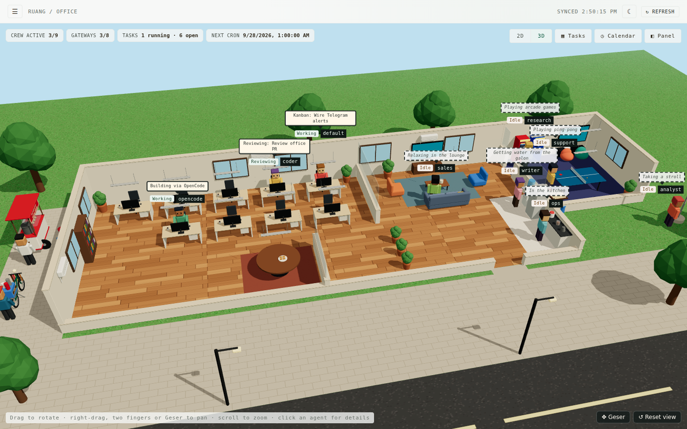
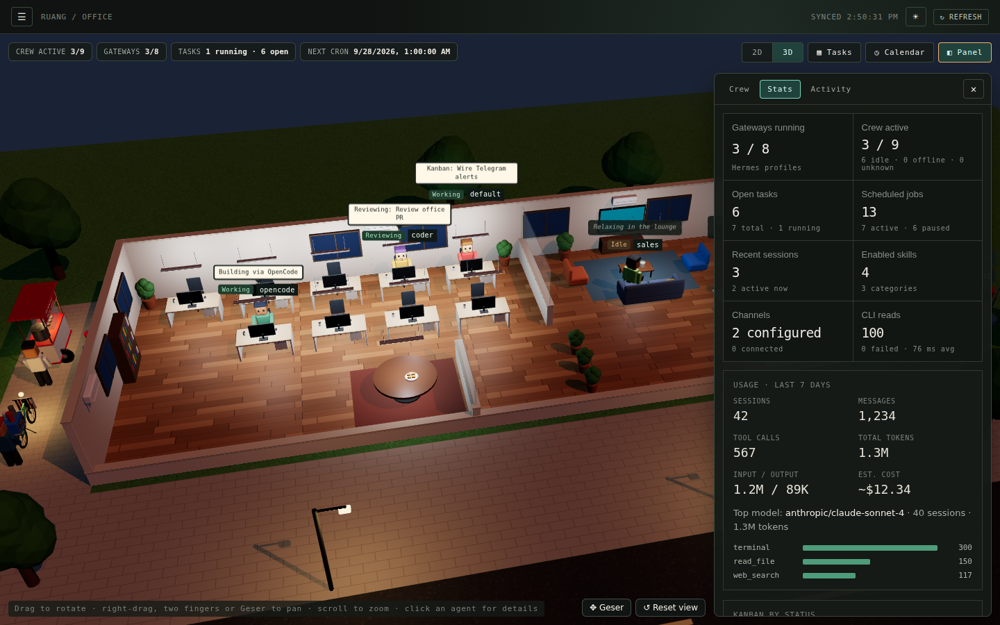

# Batcave · Multi-Agent Operations & 3D Command Center

**Batcave** is a 3D tactical command center and read-only mission control for your local [Hermes Agent](https://hermes-agent.nousresearch.com) and OpenCode crew. Monitor who is working and what they are doing in real time, inspect the Kanban board, cron schedules, session activity, agent memory, sandboxed files, and logs—all in one place. Everything is read through the `hermes` CLI with zero state mutations.





---

## Quick Install

Works on macOS, Linux, and Windows through WSL2. Requires the Hermes Agent CLI (`hermes`) installed; `opencode` is optional. The installer automatically downloads a private Node.js runtime if Node.js 20+ is not found.

```bash
curl -fsSL https://raw.githubusercontent.com/Raphonkzy/batcave-agent/main/install.sh | bash
```

Then launch the dashboard and open http://127.0.0.1:3001:

```bash
batcave                        # or: batcave --port 3005
```

* **Run as background service at boot (Linux systemd):**
  ```bash
  curl -fsSL https://raw.githubusercontent.com/Raphonkzy/batcave-agent/main/install.sh | bash -s -- --service
  loginctl enable-linger $USER
  ```
* **Update:** Rerun the installer command.
* **Uninstall:** `curl -fsSL .../install.sh | bash -s -- --uninstall`
* **On a remote server:** Batcave binds to `127.0.0.1` only. Port forward via SSH:
  ```bash
  ssh -L 3001:127.0.0.1:3001 user@server
  ```
  Then open `http://127.0.0.1:3001` in your browser.

---

## Development

Requires Node.js 20+ and `hermes` on the shell's `PATH`.

```bash
git clone https://github.com/Raphonkzy/batcave-agent.git
cd batcave-agent
npm install
npm run dev        # API on 127.0.0.1:3001 + Vite UI on http://localhost:5173
```

### Production Build

```bash
npm run build      # Builds the UI into dist/ and server into build/server/
npm start          # Runs single-process production server on http://127.0.0.1:3001
```

Verification commands: `npm run lint`, `npm test`, `npm run build`.

---

## 3D Tactical Manor (Batcave Architecture)

Batcave renders a high-performance procedural 3D environment using Three.js and React Three Fiber without external heavy assets:

* **Command Deck**: Central war table, multi-screen consoles, and operations floor.
* **Hangar Bay**: Full tactical fleet including high-altitude jet, VTOL transport, interceptor, armored tactical carrier, bikes, and a subterranean wet dock.
* **Grand Manor & Hotel Lobby**: Surface mansion with twin staircases, reception, library, lounge, and private suites.
* **Subterranean Cave & Waterfall**: Rocky chasm, dynamic cascading water mesh, and suspended command catwalks.
* **Adaptive Quality (LOD)**: Automatically adjusts between High, Medium, and Low based on device frame rates.

### Mock Crew Testing (Development Mode)

Explore the 3D space with simulated agent crews without needing Hermes CLI configured:

* `http://localhost:5173/?mockAgents=12` — spawns 12 tactical agents (bruce, barbara, dick, jason, tim, alfred, etc.).
* `http://localhost:5173/?mockAgents=cycle` — animated stress test cycling from 1 up to 40 agents.

---

## Pages & Capabilities

* **Batcave (Home)**: The interactive 3D tactical command center with HUD statistics (active crew, gateways, tasks, cron timers) and drawer panel.
* **Agents**: Roster of all discovered profiles from `hermes profile list` and OpenCode, displaying model configurations and gateway runtime states.
* **Task Board**: Hermes Kanban board visualizer with full detail modal (`hermes kanban show <id> --json`).
* **Calendar**: Monthly scheduling grid for all agent cron routines, intervals, next execution times, and overdue status.
* **Activity**: Live stream of recent sessions, messaging channels, and runtimes.
* **Memory**: Complete inspectability of `SOUL.md`, `MEMORY.md`, `USER.md`, and context files per agent with character limits and usage bars.
* **Folders**: Sandboxed file explorer for agent profiles with strict path traversal blocking and secret redaction.
* **Logs**: Live tails of `hermes logs agent|gateway|errors` with filter levels and a complete CLI command audit log.
* **Token Usage & Insights**: Aggregated token consumption, costs, top models, and tools ranked across the entire crew.
* **Settings**: Security configurations including Access Code and Profile Privacy PIN.

---

## Security

Batcave is designed with defense-in-depth principles:

* **Read-Only by Design**: Executes only fixed, sanctioned read commands; never modifies agent configurations or workspaces.
* **Automatic Secret Redaction**: Masks API keys (`sk-...`), `.env` variables, and passwords before serving API responses.
* **Access Code**: Protects the web UI with a random token (`batcave-XXXX-...`) or custom passphrase.
  * Recovery: `batcave access-code off` or `batcave access-code new`
* **Profile Lock**: Restricts visibility of sensitive agent profiles with a 6-digit PIN.
  * Recovery: `batcave profile-lock off`

---

## License

[MIT](LICENSE) © 2026 Raphonkzy
