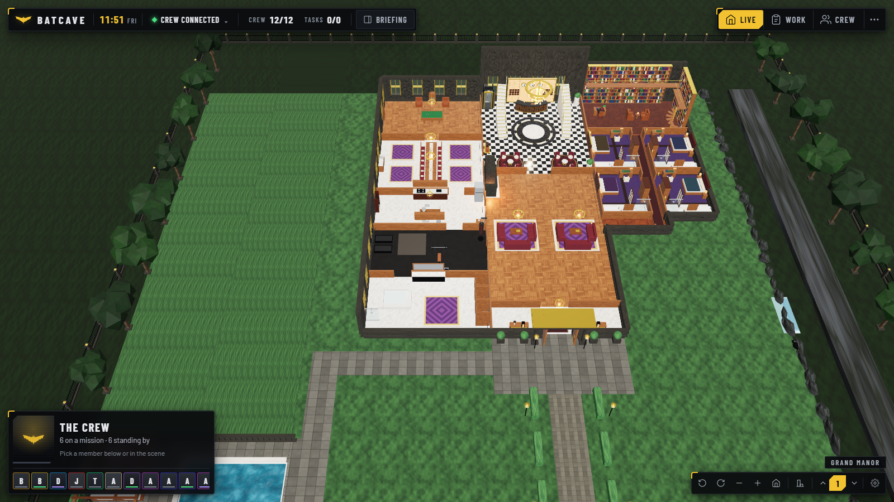
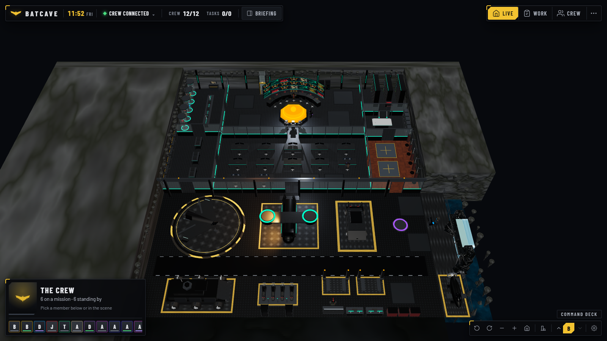
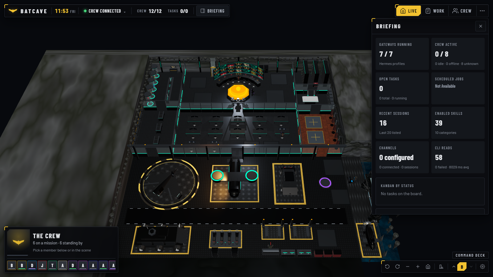
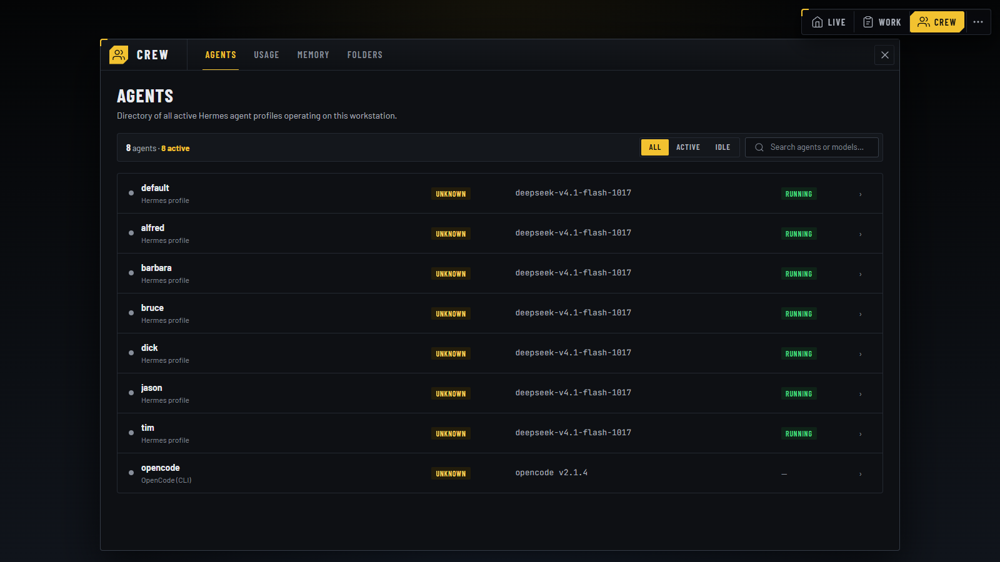
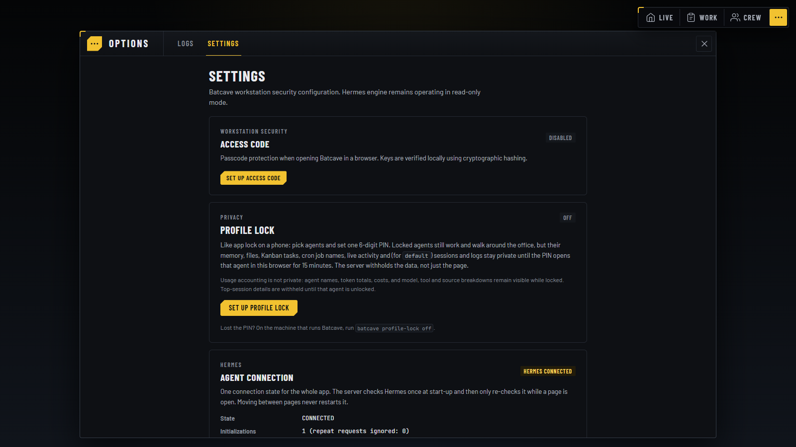

# Batcave

A 3D command center for your [Hermes Agent](https://hermes-agent.nousresearch.com) and OpenCode crew. A procedural manor shows your agents at work, and a game-style interface opens windows for missions, tasks, schedules, usage, memory, files, and logs.

Batcave is read-only. It collects everything through `hermes` and `opencode` CLI queries and never writes to your agent workspaces or databases. It runs on **Windows**, **Linux**, and **macOS**.







| Crew window | Options window |
|---|---|
|  |  |

---

## Requirements

* **Node.js 20 or newer** (the Linux/macOS installer downloads a private copy if you have none).
* **Hermes Agent CLI**: `hermes` must be on your `PATH`.
* **OpenCode CLI** (optional): `opencode` on `PATH` to show OpenCode as part of the crew.

Without `hermes`, Batcave still starts. It shows the connection as disconnected and keeps retrying.

---

## Install

### Windows (PowerShell)

```powershell
irm https://raw.githubusercontent.com/Raphonkzy/batcave-agent/main/install.ps1 | iex
```

This installs into `%LOCALAPPDATA%\batcave`, adds the `batcave` command to your user `PATH`, and needs no administrator rights. Open a new terminal, then run:

```powershell
batcave
```

To pass options, download `install.ps1` and run it: `.\install.ps1 -Version v2.0.0`, `.\install.ps1 -Tarball .\batcave-agent.tgz`, or `.\install.ps1 -Uninstall`.

### Linux, macOS, and WSL2

```bash
curl -fsSL https://raw.githubusercontent.com/Raphonkzy/batcave-agent/main/install.sh | bash
batcave
```

This installs into `~/.local/share/batcave` and the command into `~/.local/bin`. Nothing is installed system-wide and `sudo` is never used.

Run it as a background service on Linux (systemd user service):

```bash
curl -fsSL https://raw.githubusercontent.com/Raphonkzy/batcave-agent/main/install.sh | bash -s -- --service
loginctl enable-linger $USER
```

Other installer options: `--from-source`, `--version <tag>`, `--tarball <path>`, `--uninstall`.

### From source (any system)

```bash
git clone https://github.com/Raphonkzy/batcave-agent.git
cd batcave-agent
npm install
npm run build
npm start
```

Open <http://127.0.0.1:3001>.

### Update and uninstall

* **Update**: run the installer again.
* **Uninstall**: Windows `.\install.ps1 -Uninstall`; Linux/macOS add `--uninstall` to the installer (`... | bash -s -- --uninstall`).

---

## Remote servers

Batcave listens on `127.0.0.1` only. To use an instance on a remote machine, forward the port:

```bash
ssh -L 3001:127.0.0.1:3001 user@remote-host
```

Then open <http://127.0.0.1:3001> locally.

---

## Stopping the server

Press `Ctrl + C` in the terminal where it runs (on Windows, answer `Y` if asked to terminate the batch job).

If the terminal is gone, stop whatever holds port 3001:

* **Windows PowerShell**: `Stop-Process -Id (Get-NetTCPConnection -LocalPort 3001).OwningProcess -Force`
* **Linux / macOS**: `kill $(lsof -t -i:3001)`
* **systemd service**: `systemctl --user stop batcave`

---

## Using Batcave

The interface works like a house-simulation game. The 3D manor is always the main view. Pages open as windows over it, grouped into modes on the top right.

| Mode | Pages |
|---|---|
| **Live** | The 3D Batcave |
| **Work** | Missions, Task Board, Calendar, Activity |
| **Crew** | Agents, Usage, Memory, Folders |
| **Options** (`...`) | Logs, Settings |

* **Click an agent** in the scene (or its portrait in the crew card) to open a radial menu that follows the agent as it walks.
* **Briefing** (top left) opens one panel with gateways, crew, tasks, jobs, sessions, skills, channels, and CLI read statistics.
* **Status bar** shows the clock, the Hermes connection, crew and task counters.
* **Dock** (bottom right) rotates and zooms the camera, resets the view, and switches between manor floors.
* **Ctrl + K** opens the command palette.

### Routes

Every page keeps a stable address, for example `http://127.0.0.1:3001/#/agents`.

| Page | Address | Source |
|---|---|---|
| Batcave | `#/batcave` | `hermes profile list`, gateways, tasks, cron |
| Missions | `#/missions` | Missions overview from the Hermes data |
| Agents | `#/agents` | Profiles, models, runtime state |
| Usage | `#/usage` | `hermes insights` token and cost totals |
| Task Board | `#/task-board` | `hermes kanban` boards |
| Calendar | `#/calendar` | Cron jobs, agenda and month view |
| Activity | `#/activity` | Session timeline and channels |
| Memory | `#/memory` | `SOUL.md`, `MEMORY.md`, context files |
| Folders | `#/folders` | Sandboxed browser for agent profile roots |
| Logs | `#/logs` | `hermes logs` agent, gateway, errors |
| Settings | `#/settings` | Access code, profile lock, connection status |

---

## CLI

```text
Usage: batcave [options]
       batcave access-code <status|new|off>
       batcave profile-lock <status|off>

Options:
  -p, --port <port>  Port to listen on (default 3001, or BATCAVE_PORT)
  -v, --version      Print the version
  -h, --help         Show help

Access code:
  batcave access-code status  Show whether an access code is set
  batcave access-code new     Replace it with a new random code and print it
  batcave access-code off     Remove it (use this if the code is lost)

Profile lock:
  batcave profile-lock status  Show which agents are locked with the PIN
  batcave profile-lock off     Remove the PIN and unlock every agent
```

### Environment variables

| Variable | Description | Default |
|---|---|---|
| `BATCAVE_PORT` | HTTP port | `3001` |
| `BATCAVE_HERMES_ROOT` | Hermes data directory (profiles and state) | Platform default |
| `HERMES_HOME` | Alternate Hermes configuration path | Platform default |
| `BATCAVE_OPENCODE_DIR` | OpenCode data directory | `~/.opencode`, then `~/.config/opencode` |
| `BATCAVE_CONFIG_DIR` | Where Batcave keeps its access code, profile lock, and snapshot cache | `~/.config/batcave` (`$XDG_CONFIG_HOME/batcave` if set) |
| `BATCAVE_CLI_CONCURRENCY` | Maximum parallel CLI reads (1 to 8) | `4` |
| `BATCAVE_SNAPSHOT_CACHE` | Set to `0` to stop saving snapshots to disk | on |
| `BATCAVE_PREWARM` | Set to `0` to skip the data pre-load at start-up | on |
| `BATCAVE_LOG` | Set to `debug` for verbose connection logs | off |

---

## How it stays fast

Hermes is a command-line tool, not a daemon, so every read starts a process. Batcave hides that cost:

* **One persistent connection state** for the whole app. The server checks Hermes once at start-up and re-checks it only while a page is open. Moving between pages never restarts it (see the Agent connection panel in Settings).
* **Shared data store** in the browser. Pages show the last data immediately and refresh in the background, so there is no "Connecting" flash between pages.
* **Snapshots on disk** let the first screen appear right after a restart. They hold only what Hermes already stores in your home folder.
* **Bounded CLI reads**: at most 4 run at once, each with a 90 s timeout. A slow read is served from cache while it refreshes.
* **Kept-alive 3D scene**. Leaving the Batcave page pauses rendering instead of destroying the WebGL context.

Details and measurements: [docs/performance/persistent-connection.md](docs/performance/persistent-connection.md).

Diagnostics are available at `/api/agent/status` and `/api/diagnostics`. Add `?fresh=1` to a data request to skip the cache.

---

## The 3D manor

The scene is built with Three.js and React Three Fiber. All geometry and materials are generated in code, with no model or texture downloads, and no external CDN is used (fonts are bundled).

The renderer lowers quality by itself if the frame rate stays under 30 FPS for 5 seconds: shadows and reflections first, then lighting detail. You can also pick High, Medium, or Low yourself in the dock's view menu.

Development URL flags (dev server only):

* `?mockAgents=12` shows a mock crew of 12. `?mockAgents=cycle` grows and shrinks it from 1 to 40.
* `?noAutoQuality` keeps the chosen quality level, for benchmarking.

---

## Security and privacy

* **Read-only**: only fixed, hard-coded read commands are run.
* **Secret redaction**: API keys, tokens, and environment values are masked before a response leaves the server.
* **Path confinement**: the Folders browser stays inside agent profile directories and refuses symlink escapes.
* **Access code** (optional): protects every endpoint behind a passcode. Set it in Settings.
* **Profile lock** (optional): hides chosen agents' memory, files, tasks, and sessions behind a 6-digit PIN for 15 minutes per unlock.
* **Local only**: the server binds to `127.0.0.1`. Config files are written with owner-only permissions on Linux and macOS.

---

## Development

```bash
git clone https://github.com/Raphonkzy/batcave-agent.git
cd batcave-agent
npm install
npm run dev        # Vite client on :5173, API on :3001
```

| Command | Purpose |
|---|---|
| `npm run typecheck` | Type-check the client and the server |
| `npm run lint` | ESLint |
| `npm test` | Vitest suite |
| `npm run guard` | Invariant guard (routes, lock mechanisms, scene lights) |
| `npm run verify:gate` | Checks that every route differs from the baseline UI |
| `npm run build` | Build the UI and the server into `dist/` and `build/` |

Browser checks and screenshots live in `scripts/verify/` (Playwright, any OS). To refresh the README screenshots, run `npm run dev` (its mock crew only appears in development) and run:

```bash
python scripts/verify/capture-screenshots.py http://localhost:5173 docs/screenshots
```

CI runs lint, tests, build, and the package smoke test on Ubuntu and Windows.

Design notes and decisions are in [docs/batcave-redesign/DECISIONS.md](docs/batcave-redesign/DECISIONS.md).

---

## License

[MIT](LICENSE) © 2026 Raphonkzy
